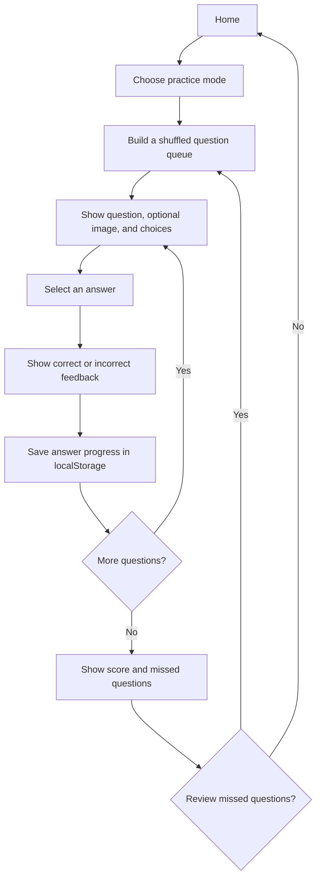

# Provisoire Quiz

A browser-based practice quiz for provisional driving-license road rules. The question bank is bundled with the client; there is no application database or account system.

## System Overview

```text
Browser
  React single-page app (Vite)
    Home page and quiz flow
    questions.json question bank
    localStorage progress, bookmarks, theme

Development: Vite serves the client and proxies hosted question images
Production: Express serves dist/public and resolves hosted question images
```

- **Client:** React 19, TypeScript, Vite, Tailwind CSS, and Wouter. `client/src/main.tsx` mounts the app; `client/src/App.tsx` provides routing, theme state, notifications, and the error boundary.
- **Quiz experience:** `client/src/pages/Home.tsx` handles the home, quiz, and results views. It filters out questions without a correct answer or at least two choices, randomizes practice, gives answer feedback, and supports bookmarks and review.
- **Question bank:** `client/src/data/questions.json` contains the questions and answer choices. `extraction-report.json` summarizes the source extraction.
- **Persistence:** `Home.tsx` stores answered IDs, correct IDs, bookmarks, and the best score in browser `localStorage`. The theme is stored there as well. This data is per browser and is not synchronized between devices.
- **Images:** A question may have an optional `image` URL. Images placed in `client/public` are served from the site root. For example, put `yield-sign.png` in `client/public/question-images/` and set the question's image to `/question-images/yield-sign.png`. Images are displayed contained within their frame to avoid cropping. Existing `/manus-storage/...` image URLs use the storage proxy and require `BUILT_IN_FORGE_API_URL` and `BUILT_IN_FORGE_API_KEY` in the environment.
- **Production server:** `server/index.ts` serves the built client from `dist/public` and handles `/manus-storage/*` requests by asking the configured storage service for a signed URL.

## User Flow



The home screen starts randomized practice and offers focused question sets. During a session, the selected answer is checked immediately, the question can be bookmarked, and progress is recorded in the current browser. At the end, results include a missed-question review and an option to retry those questions.

## Visual System

The interface uses a forest-green and warm-amber identity. Light mode uses near-white surfaces; dark mode switches to deep green-black surfaces while keeping text and controls readable. The main page styling lives in [Home.tsx](client/src/pages/Home.tsx), while shared theme tokens and typography are in [index.css](client/src/index.css).

| Use | Light mode | Dark mode |
| --- | --- | --- |
| Page background | `#f7f8f5` | `#121815` |
| Main text | `#18231f` | `#edf4ef` |
| Surface | `#ffffff` | `#19221c` |
| Primary action and progress | `#0b5c4a` | `#78cdb4` |
| Brand accent and highlights | `#d99335` | `#d99335` |
| Incorrect-answer feedback | `#d66b62` | `#d66b62` |
| Borders | `#dfe8df` | `#2e3c33` |

Body text uses DM Sans; headings use Space Grotesk. Correct-answer feedback uses the primary green. Images use `object-contain` so road signs and other diagrams remain fully visible rather than cropped.

## Question Format

Each entry in `client/src/data/questions.json` follows this shape; `image` is optional:

```json
{
  "sourceNumber": 1,
  "page": 1,
  "question": "Question text",
  "choices": [
    { "label": "a", "text": "First answer" },
    { "label": "b", "text": "Second answer" }
  ],
  "correct": "a",
  "category": "Road rules",
  "image": "/question-images/yield-sign.png"
}
```

The `correct` value must match one of the choice labels. Questions without a correct answer or with fewer than two choices are excluded from scored practice.

## Development and Build

Requires Node.js and pnpm.

```sh
pnpm install
pnpm dev
```

The Vite development server prints its local URL when it starts. Useful checks and production commands:

```sh
pnpm check
pnpm build
pnpm start
```

`pnpm build` creates the browser bundle in `dist/public` and bundles the Express server as `dist/index.js`. `pnpm start` serves that production build; set `PORT` to change the default port (`3000`). Hosted `/manus-storage/...` images additionally need the two storage environment variables listed above.
